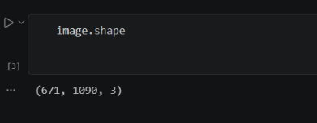
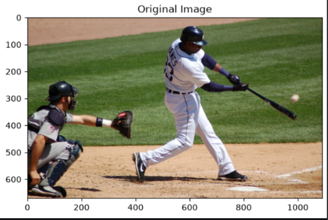
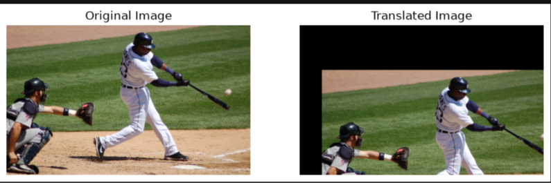
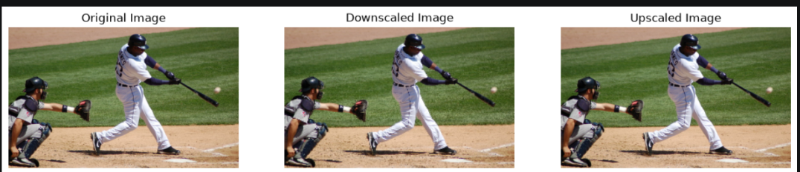
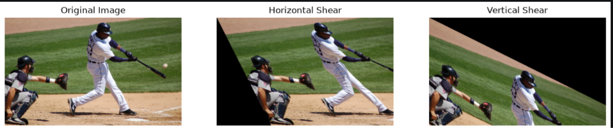
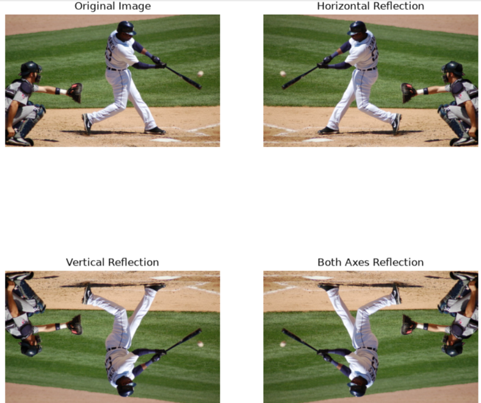
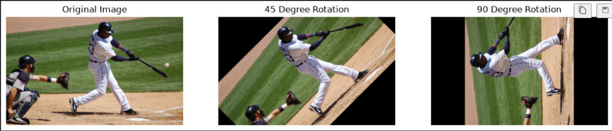

# Geometric Transformations Using OpenCV
##  NAME: NARENDRA KRISHNAN KS
## REG.NO: 212225240096  

## Aim

To write a Python program using OpenCV to perform various geometric transformations on an image.

The program performs the following operations:

- Image Translation  
- Image Scaling (Resizing)  
- Image Shearing  
- Image Reflection (Flipping)  
- Image Rotation  

---

##  Software Used

- Anaconda – Python 3.7  
- Jupyter Notebook / VS Code  
- OpenCV (`cv2`)  
- NumPy  
- Matplotlib  

---

##  Algorithm

### Step 1:
Import the required libraries: OpenCV, NumPy, and Matplotlib.

### Step 2:
Read the input image in color mode.

### Step 3: Image Translation
- Create a translation matrix to shift the image  
- Move the image 50 pixels to the right and 80 pixels down  
- Apply transformation using `cv2.warpAffine()`  
- Display original and translated images  

### Step 4: Image Scaling
- Resize the image to 0.5× (downscale)  
- Resize the image to 2× (upscale)  
- Use `cv2.resize()`  
- Display original, downscaled, and upscaled images  

### Step 5: Image Shearing
- Create transformation matrices for:
  - Horizontal shearing  
  - Vertical shearing  
- Apply transformations using `cv2.warpAffine()`  
- Display original and sheared images  

### Step 6: Image Reflection
- Perform flipping using `cv2.flip()`:
  - Horizontal reflection  
  - Vertical reflection  
  - Both axes  
- Display all reflected images  

### Step 7: Image Rotation
- Create rotation matrices for:
  - 45° rotation  
  - 90° rotation  
- Use `cv2.getRotationMatrix2D()` and `cv2.warpAffine()`  
- Display original and rotated images  

---

## PYTHON-PROGRAM:
## Image Translation

-->Write a Python program using OpenCV to perform image translation on the "Given image".

The program should:

1. Import cv2, numpy, and matplotlib.pyplot.
2. Read the image "given in color mode.
3. Create a translation matrix that moves the image
50 pixels to the right and 80 pixels down.
4. Apply the translation
5. Display the following using a 1 x 2 layout in Matplotlib:
o Original Image
o Translated Image
### PROGRAM IMPORTING THE LIBRARIE AND READING THE JPEG FILE:
~~~
import cv2
import numpy as np
import matplotlib.pyplot as plt
----
image = cv2.imread(r"C:\Users\acer\Downloads\baseball.jpeg")
~~~
### PROGRAM:
~~~
image.shape
~~~
### OUTPUT:

### PROGRAM:
~~~
# Display the image using Matplotlib

plt.imshow(image[:,:,::-1])
plt.title('Original Image')
plt.show()
~~~
### OUTPUT:

### PROGRAM:
~~~
tx, ty = 100, 200
M_translation = np.float32([[1, 0, tx],[0, 1, ty]])
translated_image = cv2.warpAffine(image, M_translation,(image.shape[1], image.shape[0]))

~~~
### PROGRAM:
~~~
plt.figure(figsize=(10,5))

plt.subplot(1,2,1)
plt.imshow(image[:,:,::-1])
plt.title("Original Image")
plt.axis("off")

plt.subplot(1,2,2)
plt.imshow(translated_image[:,:,::-1])
plt.title("Translated Image")
plt.axis("off")

plt.show()
~~~
### OUTPUT:

## Image Scaling

-->Write a Python program using OpenCV to perform image scaling on the given image.

The program should:

1. Scale the image to:
o 0.5 times its original size (downscaling)
2 times its original size (upscaling)

2. Use cv2.resize with appropriate scaling factors.
3. Display the following using a 1 x 3 layout in Matplotlib:
o Original Image
Downscaled Image (0.5x)
o Upscaled Image (2x)
### PROGRAM:
~~~
image = cv2.imread( r"C:\Users\acer\Downloads\baseball.jpeg")
----------
downscaled_image = cv2.resize(image, None,fx=0.25,fy=0.25,interpolation=cv2.INTER_LINEAR)
----------
upscaled_image = cv2.resize(image, None,fx=3,fy=3,interpolation=cv2.INTER_LINEAR)
~~~
### PROGRAM:
~~~
plt.figure(figsize=(15,5))

plt.subplot(1,3,1)
plt.imshow(image[:,:,::-1])
plt.title("Original Image")
plt.axis("off")

plt.subplot(1,3,2)
plt.imshow(downscaled_image[:,:,::-1])
plt.title("Downscaled Image")
plt.axis("off")

plt.subplot(1,3,3)
plt.imshow(upscaled_image[:,:,::-1])
plt.title("Upscaled Image")
plt.axis("off")

plt.show()
~~~
### OUTPUT:

## Image Shearing
Write a Python program using OpenCV to perform image shearing on the given image.

The program should:

1. Create a shearing transformation matrix to apply:
o Horizontal shearing
o Vertical shearing

2. Apply the shearing transformations.
3. Display the following using a 1 x 3 layout in Matplotlib:
o Original Image
o Horizontally Sheared Image
o Vertically Sheared Image

### PROGRAM:
~~~
horizontal_matrix = np.float32([[1,0.5,0],[0,1,0]])
horizontal_shear = cv2.warpAffine(image,horizontal_matrix,(image.shape[1], image.shape[0]))
------
vertical_matrix = np.float32([[1,0,0],[0.5,1,0]])
vertical_shear = cv2.warpAffine(image,vertical_matrix,(image.shape[1], image.shape[0]))
~~~
### PROGRAM:
~~~
plt.figure(figsize=(15,5))

plt.subplot(1,3,1)
plt.imshow(image[:,:,::-1])
plt.title("Original Image")
plt.axis("off")

plt.subplot(1,3,2)
plt.imshow(horizontal_shear[:,:,::-1])
plt.title("Horizontal Shear")
plt.axis("off")

plt.subplot(1,3,3)
plt.imshow(vertical_shear[:,:,::-1])
plt.title("Vertical Shear")
plt.axis("off")

plt.show()
~~~
### OUTPUT:

## IMAGE REFLECTION:

-->Write a Python program using OpenCV to perform image reflection on the given im

### The program should:

1. Generate the following reflected versions of the image:
Horizontal Reflection (flip left - right)
o Vertical Reflection (flip top - bottom)
Both-axis Reflection

2. Use cv2. flip with appropriate flip codes.
3. Display the following using a 2 x 2 layout in Matplotlib:
o Original Image
o Horizontally Reflected Image
o Vertically Reflected Image
Both-axis Reflected Image
### PROGRAM:
~~~
horizontal = cv2.flip(image,1)
vertical = cv2.flip(image,0)
both = cv2.flip(image,-1)
plt.figure(figsize=(10,10))

plt.subplot(2,2,1)
plt.imshow(image[:,:,::-1])
plt.title("Original Image")
plt.axis("off")

plt.subplot(2,2,2)
plt.imshow(horizontal[:,:,::-1])
plt.title("Horizontal Reflection")
plt.axis("off")

plt.subplot(2,2,3)
plt.imshow(vertical[:,:,::-1])
plt.title("Vertical Reflection")
plt.axis("off")

plt.subplot(2,2,4)
plt.imshow(both[:,:,::-1])
plt.title("Both Axes Reflection")
plt.axis("off")

plt.show()
~~~
### OUTPUT:

### PROGRAM:
~~~
(height, width) = image.shape[:2]

center = (width//2, height//2)
---
matrix45 = cv2.getRotationMatrix2D(center,45,1)
rotate45 = cv2.warpAffine(image,matrix45,(width,height))
---
matrix90 = cv2.getRotationMatrix2D(center,90,1)
rotate90 = cv2.warpAffine(image,matrix90,(width,height))
~~~
### PROGRAM:
~~~
plt.figure(figsize=(15,5))

plt.subplot(1,3,1)
plt.imshow(image[:,:,::-1])
plt.title("Original Image")
plt.axis("off")

plt.subplot(1,3,2)
plt.imshow(rotate45[:,:,::-1])
plt.title("45 Degree Rotation")
plt.axis("off")

plt.subplot(1,3,3)
plt.imshow(rotate90[:,:,::-1])
plt.title("90 Degree Rotation")
plt.axis("off")

plt.show()
~~~
### OUTPUT:

##  Output

### Image Translation
- Original image is displayed  
- Translated image (shifted right and down) is displayed  

### Image Scaling
- Original image is displayed  
- Downscaled image (0.5×) is displayed  
- Upscaled image (2×) is displayed  

### Image Shearing
- Original image is displayed  
- Horizontally sheared image is displayed  
- Vertically sheared image is displayed  

### Image Reflection
- Original image is displayed  
- Horizontally flipped image is displayed  
- Vertically flipped image is displayed  
- Both-axis flipped image is displayed  

### Image Rotation
- Original image is displayed  
- 45° rotated image is displayed  
- 90° rotated image is displayed  

---

##  Result

Thus, various geometric transformations such as translation, scaling, shearing, reflection, and rotation are successfully performed using OpenCV. These transformations demonstrate how images can be spatially manipulated for different computer vision applications.
